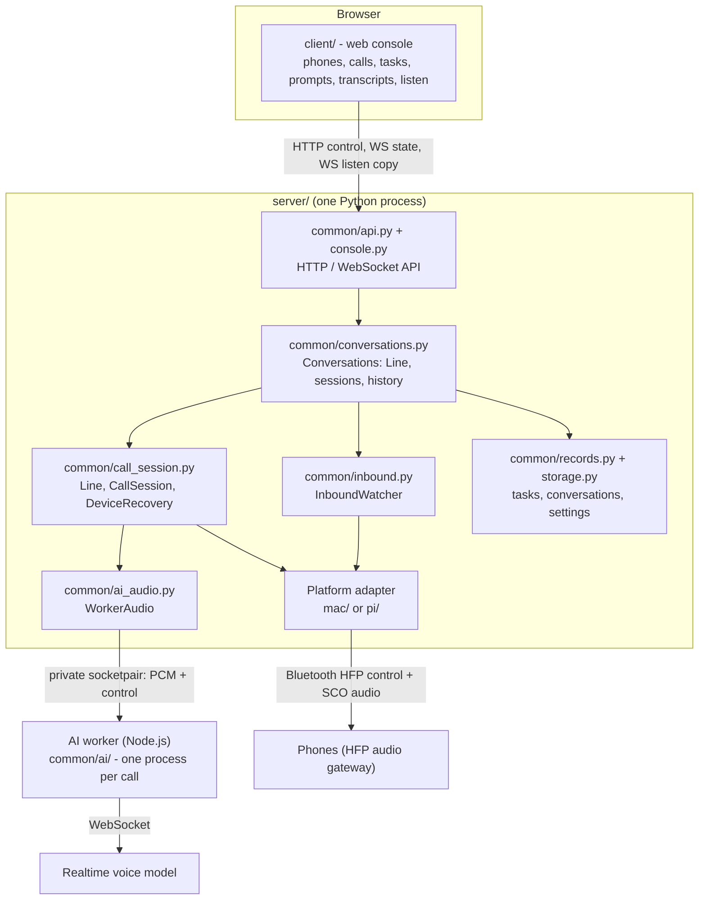
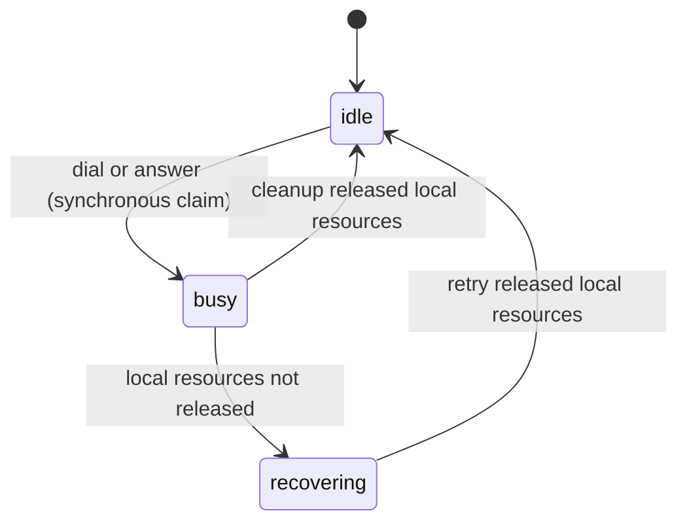
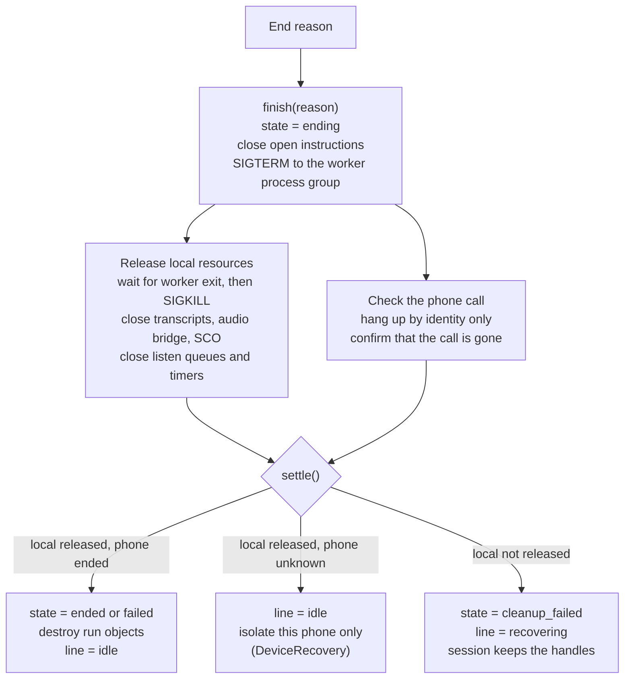
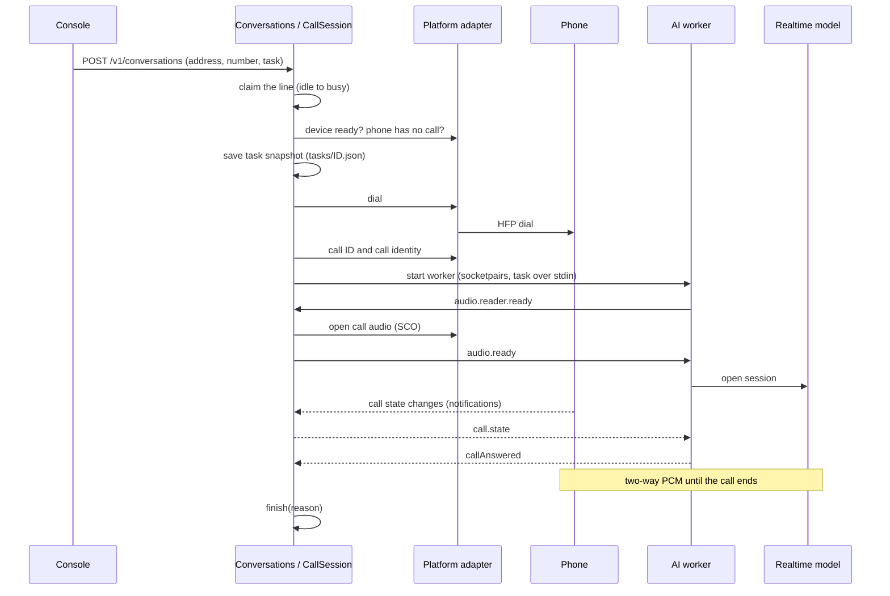
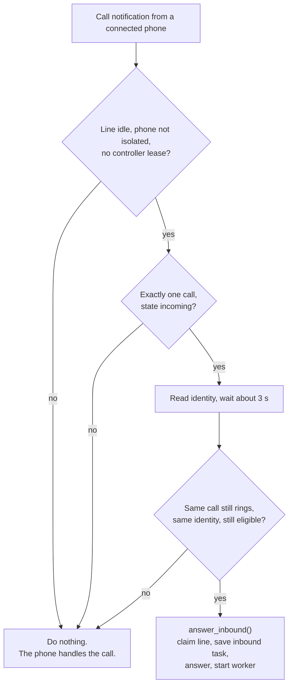
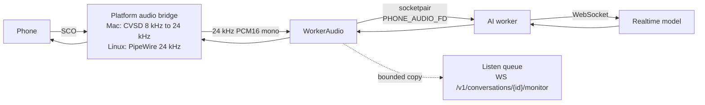

English | [简体中文](architecture.zh-CN.md)

# Architecture

This document describes the current design of the gateway. It is a guide to the code. When the code and this document are different, the code is correct.

## Summary

- One web console (`client/`) controls one server (`server/`) through HTTP and WebSocket.
- The server has one shared part (`server/common/`) and two platform adapters: `server/mac/` (Mac built-in controller) and `server/pi/` (Linux: BlueZ and PipeWire).
- The server has **one call line**. Many phones can pair, stay connected and wait. Only one call is active at a time.
- Each call (outbound or inbound) gets a new `CallSession`, a new task snapshot and a new AI worker process. All end reasons go through one cleanup. After cleanup, the server destroys the run objects of the call.
- Call audio does not go through the console. The path is phone ⇄ platform audio bridge ⇄ AI worker ⇄ realtime model. The console gets only a bounded copy for listening.

## Components

| Component | Location | Function |
| --- | --- | --- |
| Web console | `client/` | Static HTML/JS. Manages phones, starts calls, shows the line state, transcripts and the listen copy, and sends text instructions. It holds no model key and does not control Bluetooth. The server serves it at `/`. You can also serve it separately. |
| Start command | `server/__main__.py` | `python -m server` selects the platform. On Linux, it starts `server/pi`. On macOS, it starts `server/run-mac.cjs`. The launcher turns off system Bluetooth, starts `server.mac`, and turns system Bluetooth on again at exit. Windows is not supported. |
| API | `server/common/api.py`, `server/common/console.py` | Low-level device API with one controller lease, and the console API (snapshot, events, pairing, conversations, prompts, voices, listen, transcripts). |
| Conversations | `server/common/conversations.py` | Owns the `Line`, the active `CallSession`, the isolated phones and the conversation history. Creates outbound and inbound calls. Starts the AI worker. |
| Call session | `server/common/call_session.py` | `Line`, `CallSession` (one dial or answer, with one cleanup) and `DeviceRecovery` (one phone whose call state is unknown). |
| Call state | `server/common/call_state.py` | Follows the phone call state from platform notifications. It does not poll on a timer. |
| Inbound | `server/common/inbound.py`, `server/common/inbound-guard-prompt.md` | Watches connected phones for a ringing call and answers it when the line is idle. |
| Worker audio | `server/common/ai_audio.py` | Private full-duplex audio between the platform audio bridge and the AI worker. |
| Transcripts | `server/common/transcripts.py`, `server/common/records.py` | Bounded live transcript cache and the saved conversation records. |
| Pairing | `server/common/pairing.py` | Pairing sessions. A pairing response belongs to one phone and one live request. |
| Storage | `server/common/storage.py` | Private JSON files with atomic writes. |
| Mac adapter | `server/mac/` | Bumble host stack over a native bridge to the built-in controller (`server/mac/native/`). HFP control, SCO audio, numeric-comparison pairing and the pairing key file. |
| Linux adapter | `server/pi/` | BlueZ over D-Bus, PipeWire native Telephony for call control, and `pw-record` / `pw-play` / `pw-link` for call audio. |
| AI worker | `server/common/ai/` | TypeScript, one Node.js process for each call. Connects to the realtime voice model `gpt-live-1`. The model can delegate reasoning to a backend model (default `gpt-6-luna`). |

### Platform adapters

The shared code calls the adapter through one interface. The most important operations are:

- `devices()`, `capabilities()`, `connect()`, `pair()`, `remove()`, `discover()`.
- `calls(address)`: the call list of one phone.
- `operate(address, "dial" | "answer" | ...)`: native phone operations.
- `call_identity(address, call_id)`: an opaque identity of one call. Only the platform knows its parts. The shared code only compares identities.
- `hangup_owned(address, call_id, identity)`: hang up only if the call still has this identity.
- `subscribe_calls(address, callback)`: a notification when the call state of a phone changes.
- An audio factory that opens the call audio of one phone.

| Item | Mac | Linux |
| --- | --- | --- |
| Bluetooth stack | Bumble, through the native bridge to the built-in controller | BlueZ (system) |
| Call control | HFP AT commands; `+CLCC` rows and indicators | PipeWire Telephony objects over D-Bus |
| Call identity | CLCC row + call epoch + connection epoch | Telephony object path + generation |
| Call audio | SCO packets on the HCI path, CVSD, 8 kHz PCM16 | PipeWire nodes, 24 kHz PCM16 |
| Pairing | Numeric comparison; keys in `devices/pair-keys.json` | BlueZ agent: numeric comparison, passkey or PIN |
| Connected phones | One at a time; the gateway starts the connection | Many |

## Call line

The server has exactly one `Line` object. It has three states.

- **idle:** A new call can start.
- **busy:** One `CallSession` owns the line. A new dial returns 409 `line_busy`. The server does not queue the dial.
- **recovering:** The last call did not release its local resources (AI worker, audio bridge, SCO). A new dial returns 503 `line_recovering`. The session keeps the cleanup handles. `POST /v1/conversations/{id}/end` tries the local cleanup again.

The change from idle to busy is synchronous. There is no `await` between the check and the claim. Thus two requests cannot both get the line.

Pairing and connection do not use the line. The number of paired phones and the number of calls are managed separately. For the reason that there is only one line, see [Bluetooth multi-line exploration](bluetooth-multiplexing-exploration.md).

## Call session lifecycle

Each dial and each answered inbound call creates a new conversation item, a new task snapshot, a new `CallSession` and a new AI worker. The server does not use the run objects of an earlier call again.

A `CallSession` owns these resources:

- the AI worker process and its stdout watcher,
- `WorkerAudio` (audio socketpair and platform audio bridge),
- `WorkerTranscripts` (transcript socketpair),
- the `CallState` tracker,
- listen queues and instruction timers.

The conversation item (a plain dictionary) is the history record. It stays after the session is destroyed.

### Conversation states

| State | Meaning |
| --- | --- |
| `dialing` | Outbound: the server sends the dial command. |
| `answering` | Inbound: the server sends the answer command. |
| `starting` | The call is identified. The AI worker starts. |
| `active` | The call is answered and the AI worker runs. |
| `ending` | Cleanup is in progress. |
| `ended` | Cleanup is complete and there is no error. |
| `failed` | Cleanup is complete and there is an error. |
| `cleanup_failed` | Cleanup is not complete: local resources are not released, or the phone call state is unknown. |

### One cleanup for all end reasons

All end reasons call `CallSession.finish(reason)`: `remote_end`, `user_end`, `start_failed`, `answer_failed`, `ai_failed`, `worker_exit` and server stop. `finish` is idempotent. A second call waits for the first.

The local branch and the phone branch run in parallel. The results join in `settle()`.

Rules of the phone branch:

- The server hangs up only with the identity of this call (`hangup_owned`). A hang-up command that is sent is not proof that the call ended. The server confirms, within a time limit, that no call with this ID remains.
- If the call has a new identity, the server does not touch it.
- If the server did not identify a call (for example, the dial failed before a call ID), it does not send a blind hang-up.
- For an inbound call that is not confirmed as answered: if the call still rings, the phone handles it. The server does not reject it. If the call is active, the server hangs up by identity. If the query fails, the call state is unknown.

### Device recovery

When the local resources are released but the phone call state is unknown, only that phone is isolated. The line goes back to idle, and other phones can dial.

- The console shows `devices[i].recovering: true`.
- A new dial on that phone returns 409 `device_recovering`. Inbound auto-answer skips that phone.
- `DeviceRecovery` checks the phone again after each device or call notification. The isolation ends only when the phone reports no call at all.
- `POST /v1/conversations/{id}/end` on that conversation tries a hang-up again, with the same identity only.
- Recovery does not redial and does not hang up blindly. When you remove the phone pairing, the server stops the recovery and marks the conversation as `failed`.

### Identity and old events

There is one line, so the most frequent risk is an old event that changes a new call. The design prevents this with ownership and epochs:

- Each call has a `callId` and an opaque platform `identity`. Instructions, hang-up and cleanup check the identity again before they act.
- On the Mac, the identity contains the connection epoch and the call epoch. After a reconnect, an old identity does not match a new call.
- Each Mac SCO link has its own audio epoch. A new SCO request clears only the audio error of the earlier link. It does not clear an ACL or native transport error. A late disconnect of an old link does not clear the new link.
- Results of the AI worker (session ready, call answered, instruction receipts) change the item only while the session is not in cleanup.

## Outbound call

Checks before the dial:

1. The server is not stopping.
2. The line is idle (`line_busy`, `line_recovering`).
3. No low-level controller lease is active (`line_busy`).
4. The target phone is not isolated (`device_recovering`), is connected, and has no call (`phone_busy`).
5. The AI dependencies and the model provider are configured.
6. The task is valid and saved to disk. If the save fails, the server does not dial (`task_save_failed`).

If any check fails, the server releases the line and does not dial. If the dial or the worker start fails after the dial, the session goes through the same cleanup with `start_failed`.

## Inbound call

`InboundWatcher` subscribes to the call notifications of each connected phone. When the device list changes, it adds or removes subscriptions.

- The delay is `INBOUND_ANSWER_DELAY = 3` seconds. During this time, you can answer the call on the phone yourself.
- If the line is busy, the gateway does not reject the call and does not hang up. The phone rings or handles the call as usual. A call on a second phone does not interrupt the active call.
- The answer result comes from the phone call state, not from the AT or D-Bus reply. If the answer fails, the session cleans up with `answer_failed`.

### Inbound prompt

The inbound task snapshot has a fixed purpose and outcome: find out who calls, what they want and if they need a call back. The AI does not answer questions. The system prompt of the task is:

1. the shared System Prompt (`settings/system-prompt.json`),
2. then the fixed guard prompt (`server/common/inbound-guard-prompt.md`). The server reads it once at start. You cannot change it through the API. It has priority over the phone prompt.

The task content is the inbound prompt of the phone (`devices/inbound-prompts.json`), or a default text when the phone has none.

## Audio path

- The common audio format is 24 kHz, mono, PCM16 little-endian. One frame is at most 960 bytes (20 ms).
- **Mac:** The controller sends SCO packets on the HCI path (eSCO CVSD S1 or SCO CVSD D1). The host data is 8 kHz PCM16. `MacSCOAudio` converts 8 kHz to 24 kHz for capture and 24 kHz to 8 kHz for playback (`audioop.ratecv`). The gateway sends one host packet for each received packet. When no playback audio is ready, it sends silence.
- **Linux:** `PipeWireAudio` starts `pw-record` and `pw-play` at 24 kHz with 20 ms latency and links them to the SCO nodes of the phone with `pw-link`. PipeWire does the rate conversion.
- **Worker channel:** `WorkerAudio` creates a `socketpair` for each call. The child end goes to the worker as `PHONE_AUDIO_FD`. Each message is a 4-byte length, a 1-byte kind and the payload. Kind 0 is PCM. Kind 1 is JSON control (`audio.reader.ready`, `audio.ready`, `call.state`, `audio.closed`, `error`).
- **Start order:** The worker reports `audio.reader.ready`. Then the server opens the platform audio. Then the server sends `audio.ready`. The start has a 45-second limit.
- **Transcripts:** A second `socketpair` (`PHONE_TRANSCRIPT_FD`) carries transcript events from the worker. The server keeps a bounded live cache and saves each accepted event to disk.
- **Instructions:** The server writes text instructions to the worker stdin. The worker sends them to the model as `session.instructions.append` and reports the receipt on stdout.
- **Listen copy:** `CallSession.publish` copies each capture and playback frame to the listen queues (5 packets each). When a queue is full, the server drops the oldest copy. It never waits in the audio path. The first byte of a packet is 0 (phone) or 1 (AI).
- **Optional recording:** When `PHONE_RECORD_CALLS=1`, the same frames go to a background writer. It saves `conversations/<id>/call.wav` and drops frames when its queue is full. A disk error does not fail the call.
- The task text goes to the worker through stdin. It is not in arguments, environment variables or logs.

## Persistence

All data is in `PHONE_DATA_DIR` (default `~/.local/share/ai-caller/`). Directories have mode 700. Files have mode 600. JSON files are written to a temporary file, synced and then renamed.

| Path | Content |
| --- | --- |
| `tasks/<task-id>.json` | Task snapshot of one call: direction, purpose, outcome, content, source, system prompt and voice. Saved before the dial or answer. |
| `conversations/<id>/meta.json` | Record of one conversation: direction, phone address, dialed number or numeric caller ID, times, state, end reason, cleanup result, error, task ID, voice and byte counts. |
| `conversations/<id>/transcript.jsonl` | Full transcript, one event for each line (`seq`, `role`, `eventId`, `text`, `startMs`, `endMs`). |
| `conversations/<id>/call.wav` | Optional. Stereo PCM16 at 24 kHz when `PHONE_RECORD_CALLS=1`. Left is the phone, right is the AI. |
| `settings/system-prompt.json` | Shared System Prompt. |
| `devices/inbound-prompts.json` | Inbound prompt of each phone. |
| `devices/pair-keys.json` | Mac only. Pairing keys. |
| `devices/mac.json`, `devices/mac-controllers.json`, `devices/mac-names.json` | Mac only. Known phones, controller address for each phone, and Bluetooth names. |
| `logs/calls.jsonl` | Diagnostic metadata, about 2 MB for each file, 3 backups. No phone numbers, task text, transcripts, audio or keys. |

- At start, the server loads the latest 256 conversation records (not the transcripts). A record that was still active when the server stopped becomes `failed` with `server_restarted`.
- The voice selection of each phone is in memory only.
- The server saves the call's phone number in `meta.json`. Logs do not contain phone numbers. The server saves call audio only when `PHONE_RECORD_CALLS=1`. It does not save the API key.

## Concurrency model

- **One event loop.** The server runs in one Python process with one asyncio event loop (aiohttp). The API handlers, the `Line`, the sessions, the inbound watcher and the platform adapter all run on this loop. Thus the call control state changes in one order, without locks between threads. A per-phone `asyncio.Lock` serializes dial, answer and end for one phone.
- **Writer threads.** `ConversationRecords` and `Diagnostics` each have one background thread with a bounded queue. A slow disk does not block the call. When the diagnostic queue is full, the server drops entries and counts them (`droppedLogs`). Transcript reads go through the same record queue, so a read returns all events that were submitted before it. An enabled call recording has its own writer thread and drops frames when that queue is full.
- **Blocking I/O.** Task saves and prompt saves use `asyncio.to_thread`.
- **Processes.** Each call has its own AI worker process in a new process group. The Mac launcher (`run-mac.cjs`) is the parent process of the Mac server.
- **No timer polling.** Call state comes from platform notifications. After a notification, `CallState` queries the phone, with up to 3 attempts. A query failure gives `unknown`, not an end of the call.
- The threads are for I/O isolation, not for CPU speed. The CPython GIL limits CPU-bound Python threads.

## Failure handling

| Failure | Result |
| --- | --- |
| Line busy or recovering | The dial is rejected (`line_busy`, `line_recovering`). Inbound calls are not answered. |
| Task save fails | No dial (`task_save_failed`). |
| Dial raises, but the platform owns a call | The server reads the owned call ID and identity, then cleans up by identity. |
| AI worker cannot start or exits | `audio_peer_closed` or `ai_worker_failed`. Cleanup with `ai_failed` or `worker_exit`. |
| Worker does not exit | SIGTERM, then SIGKILL after 18 seconds. If it still runs, `worker_exit_failed` and the line goes to `recovering`. |
| Audio bridge does not close | `audio_cleanup_failed`. The line goes to `recovering`. `end` tries again. |
| Hang-up or phone query fails | The phone call state is `unknown`. Only that phone is isolated. |
| Remote end | The call state goes to `ended`. A worker exit or a SCO close after this is a result of the end, not an error. |
| Bluetooth disconnect during a call | The platform reports `phone_disconnected`. A disconnect is not proof that the phone call ended, so the phone can be isolated. |
| Server restart | Active records become `failed` (`server_restarted`). The server does not restore an old AI session and does not redial. |
| Mac controller firmware crash | The gateway cannot guarantee a fast recovery and cannot prove that the phone call ended. The phone keeps the call. `bluetoothd` can enter a restart loop. Turn on Bluetooth once in Control Center to recover. |

At stop, the server closes the inbound watcher, ends the current call, waits for the cleanup tasks, stops device recovery and then closes the record and diagnostic writers.

## Known limits

- The Mac adapter keeps only one phone connected. The gateway starts the connection. The phone cannot connect to the Mac gateway by itself.
- There is no authentication. Use the gateway only on `127.0.0.1` or a trusted LAN. See [SECURITY.md](../SECURITY.md).
- Bounded queues and 20 ms frames do not guarantee audio without gaps.
- An instruction receipt from the model does not prove that the AI said the words or that the other party heard them.

## Related documents

- [Server and API](../server/README.md)
- [AI configuration](../server/common/ai/README.md)
- [Mac built-in Bluetooth](../server/mac/native/README.md)
- [Linux deployment](../server/pi/deploy/README.md)
- [Bluetooth multi-line exploration](bluetooth-multiplexing-exploration.md)
