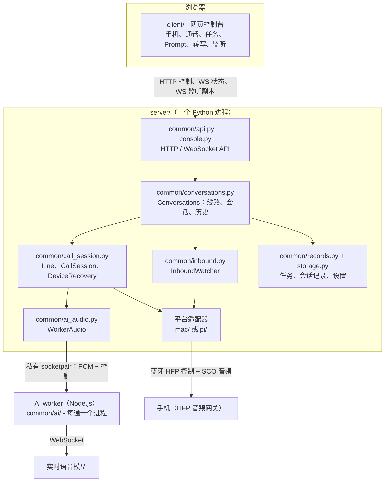
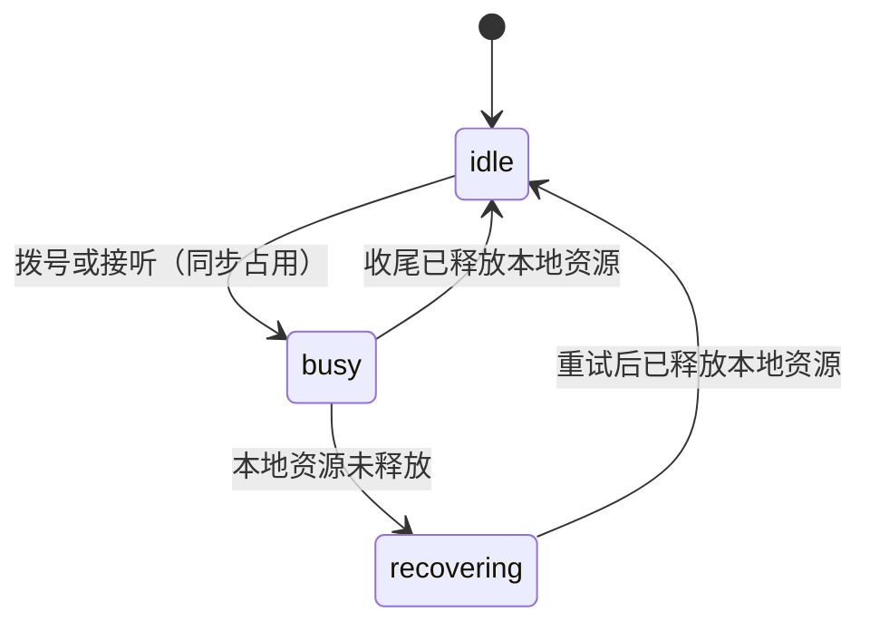
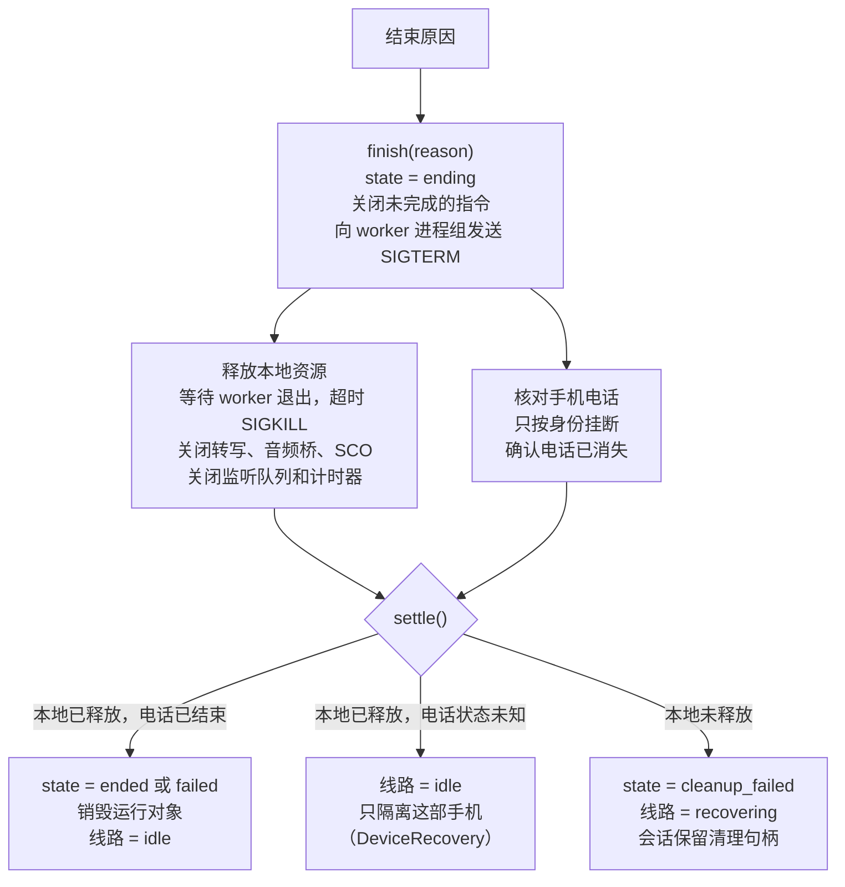
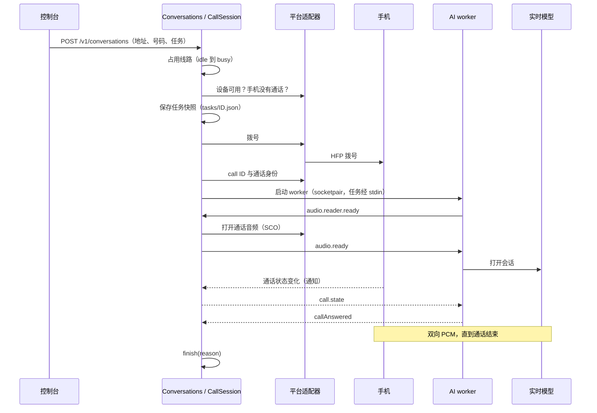
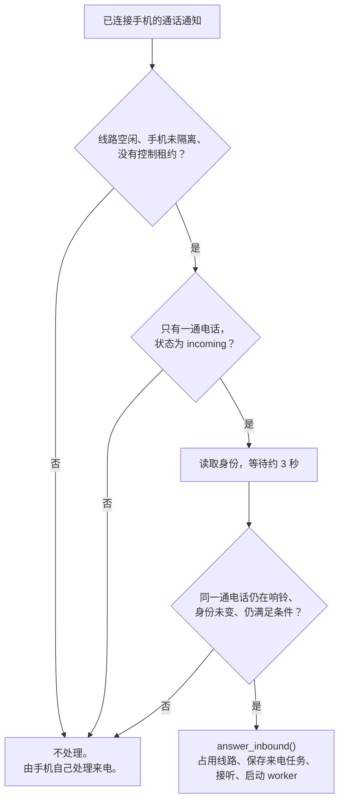
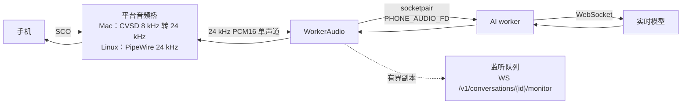

[English](architecture.md) | 简体中文

# 架构

本文说明网关的现行设计，作为阅读代码的指南。本文与代码不一致时，以代码为准。

## 概要

- 一个网页控制台（`client/`）通过 HTTP 和 WebSocket 控制一个 Server（`server/`）。
- Server 由公共部分（`server/common/`）和两个平台适配器组成：`server/mac/`（Mac 内置控制器）和 `server/pi/`（Linux：BlueZ 与 PipeWire）。
- Server 只有**一条通话线路**。多部手机可以配对、保持连接和待命，但同一时间只有一路通话。
- 每通电话（拨出或来电）都新建 `CallSession`、任务快照和 AI worker 进程。所有结束原因走同一套收尾。收尾后，Server 销毁本次通话的运行对象。
- 通话音频不经过控制台。主链路是：手机 ⇄ 平台音频桥 ⇄ AI worker ⇄ 实时模型。控制台只接收用于监听的有界副本。

## 组件

| 组件 | 位置 | 职责 |
| --- | --- | --- |
| 网页控制台 | `client/` | 静态 HTML/JS。管理手机、发起通话，显示线路状态、转写和监听副本，发送文字指令。不持有模型密钥，不直接控制蓝牙。Server 在 `/` 提供它，也可以单独提供。 |
| 启动命令 | `server/__main__.py` | `python -m server` 按系统选择平台。Linux 启动 `server/pi`；macOS 启动 `server/run-mac.cjs`。该启动器先关闭系统蓝牙，再启动 `server.mac`，退出时重新打开系统蓝牙。不支持 Windows。 |
| API | `server/common/api.py`、`server/common/console.py` | 带单一控制租约的底层设备 API，以及控制台 API（快照、事件、配对、会话、Prompt、音色、监听、转写）。 |
| 会话管理 | `server/common/conversations.py` | 拥有 `Line`、当前 `CallSession`、被隔离的手机和会话历史。创建拨出和来电会话，启动 AI worker。 |
| 通话会话 | `server/common/call_session.py` | `Line`、`CallSession`（一次拨号或接听及其统一收尾）和 `DeviceRecovery`（一部电话状态未知的手机）。 |
| 通话状态 | `server/common/call_state.py` | 按平台通知跟踪手机通话状态，不定时轮询。 |
| 来电 | `server/common/inbound.py`、`server/common/inbound-guard-prompt.md` | 监听已连接手机的来电，线路空闲时接听。 |
| Worker 音频 | `server/common/ai_audio.py` | 平台音频桥与 AI worker 之间的私有全双工音频。 |
| 转写 | `server/common/transcripts.py`、`server/common/records.py` | 有界的实时转写缓存和持久化的会话记录。 |
| 配对 | `server/common/pairing.py` | 配对会话。配对响应只属于一部手机和一次进行中的请求。 |
| 存储 | `server/common/storage.py` | 原子写入的私有 JSON 文件。 |
| Mac 适配器 | `server/mac/` | Bumble 协议栈，经原生桥接（`server/mac/native/`）使用内置控制器。HFP 控制、SCO 音频、数字比较配对和配对密钥文件。 |
| Linux 适配器 | `server/pi/` | 通过 D-Bus 使用 BlueZ，用 PipeWire 原生 Telephony 控制通话，用 `pw-record` / `pw-play` / `pw-link` 传输通话音频。 |
| AI worker | `server/common/ai/` | TypeScript，每通电话一个 Node.js 进程。连接实时语音模型 `gpt-live-1`，可按需把推理委派给后端模型（默认 `gpt-6-luna`）。 |

### 平台适配器

公共代码通过同一套接口调用适配器。主要操作：

- `devices()`、`capabilities()`、`connect()`、`pair()`、`remove()`、`discover()`。
- `calls(address)`：一部手机的通话列表。
- `operate(address, "dial" | "answer" | ...)`：原生电话操作。
- `call_identity(address, call_id)`：一通电话的不透明身份。只有平台知道它的组成；公共代码只比较身份。
- `hangup_owned(address, call_id, identity)`：只有电话仍是这个身份时才挂断。
- `subscribe_calls(address, callback)`：手机通话状态变化时发出通知。
- 一个音频工厂，用于打开一部手机的通话音频。

| 项目 | Mac | Linux |
| --- | --- | --- |
| 蓝牙协议栈 | Bumble，经原生桥接使用内置控制器 | BlueZ（系统） |
| 通话控制 | HFP AT 命令；`+CLCC` 行与指示器 | 通过 D-Bus 使用 PipeWire Telephony 对象 |
| 通话身份 | CLCC 行 + 通话代次 + 连接代次 | Telephony 对象路径 + 代次 |
| 通话音频 | HCI 路径上的 SCO 包，CVSD，8 kHz PCM16 | PipeWire 节点，24 kHz PCM16 |
| 配对 | 数字比较；密钥保存在 `devices/pair-keys.json` | BlueZ Agent：数字比较、Passkey 或 PIN |
| 已连接手机 | 同一时间一部；由网关发起连接 | 多部 |

## 通话线路

Server 只有一个 `Line` 对象，共三种状态。

- **idle（空闲）：** 可以开始新通话。
- **busy（占用）：** 一个 `CallSession` 占用线路。新拨号返回 409 `line_busy`，不排队。
- **recovering（恢复中）：** 上一通没有释放本地资源（AI worker、音频桥、SCO）。新拨号返回 503 `line_recovering`。该会话继续持有清理句柄。`POST /v1/conversations/{id}/end` 会再次尝试本地收尾。

从空闲到占用是同步切换，检查与占用之间没有 `await`，所以两个请求不可能同时取得线路。

配对和连接不占用线路。配对数量与通话路数分开管理。只有一条线路的原因见 [蓝牙多路通话复用探索记录](bluetooth-multiplexing-exploration.zh-CN.md)。

## 通话会话生命周期

每次拨号、每次接听来电，都新建会话条目、任务快照、`CallSession` 和 AI worker。Server 不复用上一通的运行对象。

`CallSession` 拥有以下资源：

- AI worker 进程及其 stdout 监视任务；
- `WorkerAudio`（音频 socketpair 与平台音频桥）；
- `WorkerTranscripts`（转写 socketpair）；
- `CallState` 跟踪器；
- 监听队列和指令计时器。

会话条目（普通字典）是历史记录。会话销毁后它仍然保留。

### 会话状态

| 状态 | 含义 |
| --- | --- |
| `dialing` | 拨出：Server 正在发送拨号命令。 |
| `answering` | 来电：Server 正在发送接听命令。 |
| `starting` | 已识别本次电话，AI worker 正在启动。 |
| `active` | 电话已接通，AI worker 正在运行。 |
| `ending` | 正在收尾。 |
| `ended` | 收尾完成，没有错误。 |
| `failed` | 收尾完成，有错误。 |
| `cleanup_failed` | 收尾未完成：本地资源未释放，或手机电话状态未知。 |

### 所有结束原因走同一套收尾

所有结束原因都调用 `CallSession.finish(reason)`：`remote_end`、`user_end`、`start_failed`、`answer_failed`、`ai_failed`、`worker_exit` 以及服务停止。`finish` 是幂等的；第二次调用会等待第一次完成。

本地资源分支和手机电话分支并行执行，结果在 `settle()` 中汇合。

手机电话分支的规则：

- Server 只按本次电话的身份挂断（`hangup_owned`）。挂断命令发出不等于电话已结束；Server 在时限内确认手机上已没有这个 ID 的电话。
- 如果电话已是新身份，Server 不操作它。
- 如果 Server 没有识别出本次电话（例如拿到 call ID 前拨号就失败），不发送盲目的挂断。
- 未确认接通的来电：仍在响铃时由手机处理，Server 不拒接；已接通时按身份挂断；查询失败时电话状态未知。

### 设备恢复

本地资源已释放、但手机电话状态未知时，只隔离这部手机。线路回到空闲，其他手机可以拨号。

- 控制台显示 `devices[i].recovering: true`。
- 对这部手机的新拨号返回 409 `device_recovering`；来电自动接听跳过这部手机。
- 每次设备或通话通知后，`DeviceRecovery` 重新核对这部手机。只有手机报告没有任何通话时，隔离才解除。
- 对该会话调用 `POST /v1/conversations/{id}/end` 会再次尝试挂断，仍只使用同一个身份。
- 恢复不会重拨，也不会盲目挂断。删除这部手机的配对时，Server 停止恢复，并把该会话标为 `failed`。

### 身份与旧事件

只有一条线路时，最常见的风险是旧事件修改新通话。设计通过归属和代次防止这种情况：

- 每通电话有 `callId` 和平台定义的不透明 `identity`。指令、挂断和收尾在执行前再次核对身份。
- Mac 上，身份包含连接代次和通话代次。重连后，旧身份不会匹配新电话。
- Mac 的每条 SCO 链路有自己的音频代次。新的 SCO 请求只清除上一条链路的音频错误，不清除 ACL 或原生传输错误。旧链路迟到的断开不会清空新链路。
- AI worker 的结果（会话就绪、电话接通、指令回执）只在会话未进入收尾时修改条目。

## 拨出电话

拨号前的检查：

1. Server 没有在停止。
2. 线路空闲（否则 `line_busy`、`line_recovering`）。
3. 没有底层控制租约（否则 `line_busy`）。
4. 目标手机未被隔离（否则 `device_recovering`），已连接，且没有通话（否则 `phone_busy`）。
5. AI 依赖和模型 provider 已配置。
6. 任务有效且已写入磁盘。写入失败时不拨号（`task_save_failed`）。

任何一项失败，Server 释放线路且不拨号。拨号之后如果拨号结果或 worker 启动失败，会话以 `start_failed` 走同一套收尾。

## 来电

`InboundWatcher` 订阅每部已连接手机的通话通知。设备列表变化时，它增加或删除订阅。

- 等待时间为 `INBOUND_ANSWER_DELAY = 3` 秒。在此期间，机主可以先在手机上自己接听。
- 线路占用时，网关不拒接、不挂断，手机照常响铃或处理来电。第二部手机的来电不会打断当前通话。
- 接听结果以手机通话状态为准，不以 AT 或 D-Bus 的回复为准。接听失败时，会话以 `answer_failed` 收尾。

### 来电 Prompt

来电任务快照的目的和结果是固定的：问清对方是谁、有什么事、是否需要回电；AI 不回答问题。任务的 system prompt 依次为：

1. 全局 System Prompt（`settings/system-prompt.json`）；
2. 固定的保护 prompt（`server/common/inbound-guard-prompt.md`）。Server 启动时读取一次，API 不能修改，优先级高于手机的来电 prompt。

任务内容是该手机的来电 prompt（`devices/inbound-prompts.json`）；未配置时使用默认文本。

## 音频路径

- 公共音频格式为 24 kHz、单声道、PCM16 小端。一帧最多 960 字节（20 ms）。
- **Mac：** 控制器经 HCI 路径收发 SCO 包（eSCO CVSD S1 或 SCO CVSD D1），主机侧数据为 8 kHz PCM16。`MacSCOAudio` 用 `audioop.ratecv` 把采集音频从 8 kHz 转为 24 kHz，把播放音频从 24 kHz 转为 8 kHz。每收到一个包就回送一个包；没有待播放的音频时发送静音。
- **Linux：** `PipeWireAudio` 以 24 kHz、20 ms 延迟启动 `pw-record` 和 `pw-play`，再用 `pw-link` 连接到该手机的 SCO 节点。采样率转换由 PipeWire 完成。
- **Worker 通道：** `WorkerAudio` 为每通电话创建一个 `socketpair`，子端以 `PHONE_AUDIO_FD` 交给 worker。每条消息为 4 字节长度、1 字节类型和负载。类型 0 是 PCM，类型 1 是 JSON 控制消息（`audio.reader.ready`、`audio.ready`、`call.state`、`audio.closed`、`error`）。
- **启动顺序：** worker 先报告 `audio.reader.ready`，Server 再打开平台音频，然后发送 `audio.ready`。启动时限为 45 秒。
- **转写：** 第二个 `socketpair`（`PHONE_TRANSCRIPT_FD`）传送 worker 的转写事件。Server 保留有界的实时缓存，并把每条接受的事件写入磁盘。
- **指令：** Server 把文字指令写入 worker 的 stdin。worker 以 `session.instructions.append` 发给模型，并在 stdout 报告回执。
- **监听副本：** `CallSession.publish` 把每帧采集和播放音频复制到监听队列（每个队列 5 个包）。队列满时丢弃最旧的副本，从不在音频路径中等待。包的第一个字节为 0（手机）或 1（AI）。
- 任务正文经 stdin 交给 worker，不出现在命令行参数、环境变量或日志中。

## 持久化

所有数据位于 `PHONE_DATA_DIR`（默认 `~/.local/share/phone-call-gateway/`）。目录权限 700，文件权限 600。JSON 文件先写临时文件并同步到磁盘，再重命名。

| 路径 | 内容 |
| --- | --- |
| `tasks/<task-id>.json` | 一通电话的任务快照：方向、目的、结果、内容、来源、system prompt 和音色。在拨号或接听前保存。 |
| `conversations/<id>/meta.json` | 一个会话的记录：方向、手机地址、时间、状态、结束原因、收尾结果、错误、任务 ID、音色和字节数。不含电话号码。 |
| `conversations/<id>/transcript.jsonl` | 完整转写，每行一条事件（`seq`、`role`、`eventId`、`text`、`startMs`、`endMs`）。 |
| `settings/system-prompt.json` | 全局 System Prompt。 |
| `devices/inbound-prompts.json` | 每部手机的来电 prompt。 |
| `devices/pair-keys.json` | 仅 Mac。配对密钥。 |
| `devices/mac.json`、`devices/mac-controllers.json`、`devices/mac-names.json` | 仅 Mac。已知手机、每部手机对应的控制器地址和蓝牙名称。 |
| `logs/calls.jsonl` | 诊断元数据，每个文件约 2 MB，保留 3 个备份。不含电话号码、任务正文、转写、音频或密钥。 |

- 启动时，Server 加载最近 256 条会话记录（不加载转写正文）。上次停止时仍在进行的记录标为 `failed`，错误为 `server_restarted`。
- 每部手机的音色选择只保存在内存中。
- Server 不保存通话音频、电话号码或 API 密钥。

## 并发模型

- **一个事件循环。** Server 是一个 Python 进程，运行一个 asyncio 事件循环（aiohttp）。API 处理、`Line`、会话、来电监听和平台适配器都在这个循环中运行。因此通话控制状态按单一顺序变化，不需要线程之间的锁。每部手机一个 `asyncio.Lock`，串行处理这部手机的拨号、接听和结束。
- **写入线程。** `ConversationRecords` 和 `Diagnostics` 各有一个后台线程和有界队列。磁盘慢不会阻塞通话。诊断队列满时丢弃条目并计数（`droppedLogs`）。转写读取也排在同一个记录队列中，所以读取会返回在它之前提交的全部事件。
- **阻塞 I/O。** 保存任务和 Prompt 使用 `asyncio.to_thread`。
- **进程。** 每通电话有自己的 AI worker 进程，位于新的进程组中。Mac 启动器（`run-mac.cjs`）是 Mac Server 的父进程。
- **不定时轮询。** 通话状态来自平台通知。收到通知后，`CallState` 查询手机，最多尝试 3 次。查询失败的结果是 `unknown`，不是通话结束。
- 线程用于隔离 I/O，不用于提高 CPU 速度。CPython 的 GIL 限制 CPU 密集的 Python 线程并行。

## 故障处理

| 故障 | 结果 |
| --- | --- |
| 线路占用或恢复中 | 拒绝拨号（`line_busy`、`line_recovering`），不接听来电。 |
| 任务保存失败 | 不拨号（`task_save_failed`）。 |
| 拨号报错，但平台已拥有一通电话 | Server 读取平台拥有的 call ID 和身份，再按身份收尾。 |
| AI worker 无法启动或退出 | `audio_peer_closed` 或 `ai_worker_failed`；以 `ai_failed` 或 `worker_exit` 收尾。 |
| Worker 不退出 | 先 SIGTERM，18 秒后 SIGKILL。仍未退出时记为 `worker_exit_failed`，线路进入 `recovering`。 |
| 音频桥无法关闭 | `audio_cleanup_failed`，线路进入 `recovering`；`end` 会再次尝试。 |
| 挂断或手机查询失败 | 手机电话状态为 `unknown`，只隔离这部手机。 |
| 对方挂断 | 通话状态变为 `ended`。此后的 worker 退出或 SCO 关闭是结束的结果，不算错误。 |
| 通话中蓝牙断开 | 平台报告 `phone_disconnected`。断开不能证明手机电话已结束，所以该手机可能被隔离。 |
| Server 重启 | 进行中的记录标为 `failed`（`server_restarted`）。不恢复旧 AI 会话，不重拨。 |
| Mac 控制器固件崩溃 | 网关不能保证快速恢复，也不能证明手机电话已结束；手机上的通话会继续。`bluetoothd` 可能进入重启循环，需要在控制中心打开一次蓝牙来恢复。 |

停止时，Server 先关闭来电监听，结束当前通话，等待收尾任务，停止设备恢复，然后关闭记录和诊断写入线程。

## 已知限制

- Mac 适配器同一时间只保持一部手机连接，由网关发起连接；手机不能主动连接 Mac 网关。
- 没有鉴权。只在 `127.0.0.1` 或可信局域网中使用。见 [SECURITY.zh-CN.md](../SECURITY.zh-CN.md)。
- 有界队列和 20 ms 帧不能保证音频没有间断。
- 模型的指令回执不能证明 AI 说了这些话，也不能证明对方听到了。

## 相关文档

- [Server 与 API](../server/README.zh-CN.md)
- [AI 配置](../server/common/ai/README.zh-CN.md)
- [Mac 内置蓝牙](../server/mac/native/README.zh-CN.md)
- [Linux 部署](../server/pi/deploy/README.zh-CN.md)
- [蓝牙多路通话复用探索记录](bluetooth-multiplexing-exploration.zh-CN.md)
